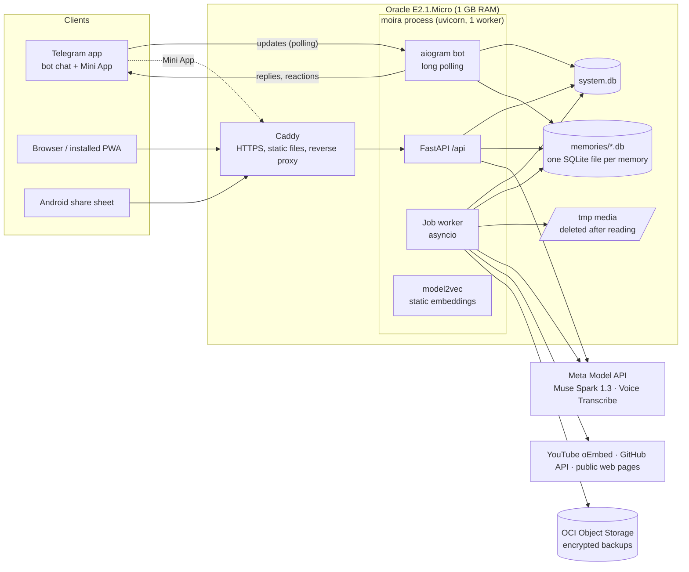

# Architecture

For developers and agents who need the big picture before touching code. The full spec is [blueprint §5](docs/blueprint/BLUEPRINT.md).

## Diagram

## Module map

| Module | Role |
|---|---|
| `backend/src/moira/domain/` | Pure types; imports nothing from the project |
| `capture/` | Secret masking, exact strings, URLs, grouping, question detection |
| `readers/` | Link readers and the SSRF guard |
| `media/` | Audio, images, video: read → text → delete |
| `ai/` | The only place that builds prompts; Responses/ASR client, budgets, schemas, FakeLLM |
| `memory/` | Filing, facts, people, placement, importance, forget, undo |
| `embed/` | model2vec static embeddings |
| `search/` | Time grammar, parsing, FTS, vectors, fusion, answer tiers |
| `jobs/` | SQLite-backed job queue and worker |
| `bot/`, `api/` | Thin handlers: parse → call a service → format |
| `db/` | Connections, migrations, repositories (all SQL lives here) |
| `sandbox/`, `backup/`, `eval/` | Sample-memory sandboxes, backups and export, benchmark |
| `web/src/` | `sky/` canvas renderer, `components/`, `state/`, `api/`, `lib/`, `styles/` |

## Data flow of a save

_To be written with T14 (capture service) and T23 (filing)._

## Data flow of a question

_To be written with T28 (answer tier) and T30 (SSE)._

## Key invariants

See [blueprint §6.4](docs/blueprint/BLUEPRINT.md) and [docs/reference/DATA_MODEL.md](docs/reference/DATA_MODEL.md).
