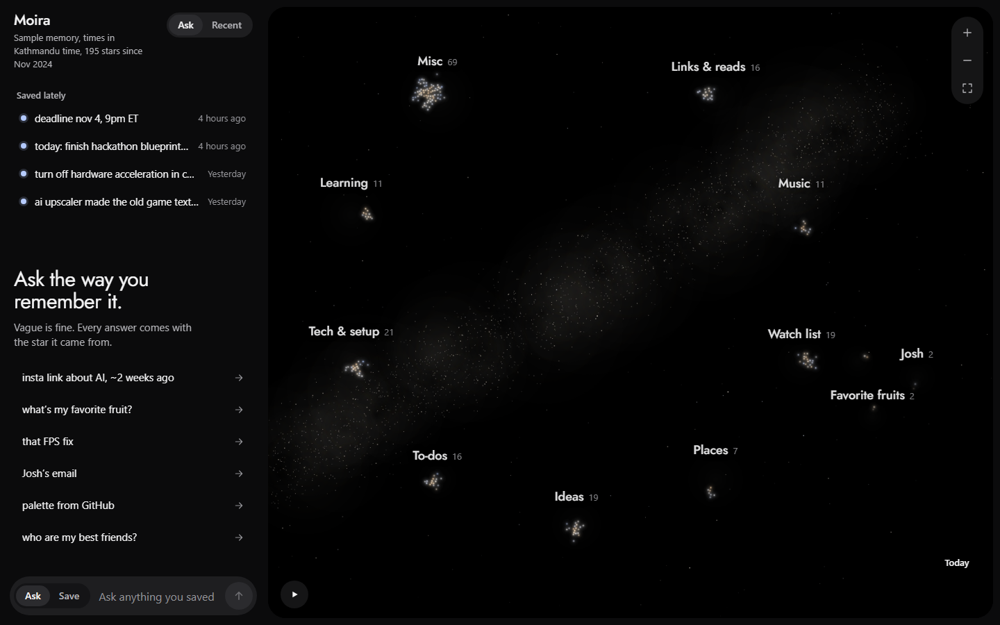
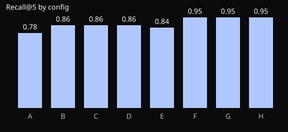

# Moira

For anyone who wants to know what Moira is, try it, or run it.

> Text it like a friend. Ask it like a friend.

Moira is a memory you text. Send it anything (text, a link, a screenshot, a voice note, a short
screen recording) through Telegram or the web app, and forget about it. At save time Moira
reads it, researches bare links on the web, files everything as text, and keeps your facts up
to date with their history. Later it finds anything again from a vague memory: "insta link
about AI, two weeks ago". Your memory is drawn as a night sky, and every answer flies you to
the exact star it came from.

Named after the Moirai of Greek myth, who spin and measure the thread of every life.

Built for the Meta Global AI Developer Hackathon (Indie developer track, theme "Build for Your
World").

## Try it

- **Live app:** _link added at deploy_ → **Try the sample memory**. No sign-in; you get a
  private copy for 24 hours. Every item in it is fictional.
- **Judges, in Telegram:** `t.me/<bot>?start=<judge-code>` (in the submission) opens your own
  private copy of the sample memory, valid until 20 Nov.
- **How to judge it in a minute:** Try the sample memory → tap any suggestion → **Show in sky**.

## What happens when you save something

1. **Capture never asks.** The bot reacts with 👌 and nothing else; the web shows a comet that
   lands as a new star. Passwords, card numbers and codes are hidden before anything is stored.
2. **Read.** Screenshots become text; voice notes are transcribed with names from your own
   memory as hints; short screen recordings are read (speech, on-screen text, the creator).
3. **Research.** A bare or login-walled link is researched on the web at save time, with
   citations checked in code against the post ID. It stays readable even if the post goes away.
4. **File.** Each save gets a title, a summary, the questions you might later ask, and its
   constellations, through structured output that code validates.
5. **Update facts with history.** "My favorite fruit is now banana" moves apple to **Earlier**
   and shows **Now: banana**. Only your own words can change a fact, never found content, so a
   web page that says "ignore your instructions" cannot change anything.

Then **ask the way you remember**: time, source, people and topic together, even when the date
you remember is a bit off. Every answer cites the stars it came from.

## How Meta AI is used

| Meta tool | Role in Moira |
|---|---|
| Muse Spark 1.3, vision | Reads screenshots and photos into text at save time |
| Muse Spark 1.3, structured output | Files every save: title, summary, questions, constellations, fact updates |
| Muse Spark 1.3, web search | Researches bare and login-walled links, with citations verified in code |
| Muse Spark 1.3, video understanding | Reads short screen recordings (speech, on-screen text, handle) |
| Muse Spark 1.3, reasoning | Plans vague questions and writes cited answers |
| Muse Voice Transcribe | Voice notes to text, biased toward names in your own memory |

Every request sends `store=false`. Prompts are versioned files in
[`backend/src/moira/ai/prompts/`](backend/src/moira/ai/prompts/); see [PROMPTS](docs/reference/PROMPTS.md).

## Architecture

One Python 3.12 process (FastAPI, the aiogram bot and a job worker) with one SQLite file per
memory (WAL, FTS5, sqlite-vec) on a free 1 GB server behind Caddy. Search fuses full text,
trigrams, exact strings, vectors (Model2Vec, on the CPU) and time priors that widen the older
side, because people remember old things as more recent than they were. The web app is Preact
with a Canvas 2D sky. More in [ARCHITECTURE.md](ARCHITECTURE.md) and
[SEARCH](docs/explanation/SEARCH.md).

## Benchmark

40 vague questions over the sample memory, with ablations from plain full text (A) to the full
pipeline (H). The numbers below come from **FakeLLM**: they check the retrieval pipeline, not the
model. Real-model results are added to [RESULTS.md](docs/eval/RESULTS.md) when the API key is
in place.

| Config | R@1 | R@5 | MRR@10 |
|---|---|---|---|
| A: full text only | 0.59 | 0.78 | 0.68 |
| F: + time priors and fusion | 0.76 | 0.95 | 0.83 |
| H: full pipeline | 0.76 | 0.95 | 0.83 |

## Cost

Hosting is $0 on a free 1 GB server. The AI costs about $3 a month for everyday use (10 saves
and 3 questions a day) and up to $10 at very heavy use. Daily caps per user and globally keep it
there; when a cap is hit, saving and instant search keep working.

## Limitations

- English only for transcription, filing and the time grammar.
- Nothing behind a login is ever read; such links are researched from public sources only.
- iPhones cannot share into web apps, so iPhone users share to the Telegram bot.
- Videos up to 90 seconds; longer ones get a "send a screenshot instead" reply.

## How it was built

Moira was built during the event with **Claude Code**, one task at a time from the
[blueprint](docs/blueprint/BLUEPRINT.md) (Appendix M). Claude Code wrote most of the code. The
developer made the product and design decisions, wrote the blueprint, reviews the pull requests,
tests on real phones, and prepares the sample data, the evaluation and the video. Every
AI-assisted commit carries an `Assisted-by: Claude Code` trailer, and [DEVLOG.md](DEVLOG.md)
records each work session. Questions the blueprint did not answer are in
[OPEN_QUESTIONS.md](docs/OPEN_QUESTIONS.md).

## Quick start

See [LOCAL_DEV](docs/howto/LOCAL_DEV.md). In short: `make setup`, then `make dev` (a fake model
runs unless `MODEL_API_KEY` is set). Tests: `make test`, `make test-web`, `make e2e`.

## Documentation

- [Blueprint](docs/blueprint/BLUEPRINT.md) · [Decisions](docs/adr/) · [Open questions](docs/OPEN_QUESTIONS.md)
- [API](docs/reference/API.md) · [Data model](docs/reference/DATA_MODEL.md) · [Config](docs/reference/CONFIG.md)
- [Deploy](docs/howto/DEPLOY.md) · [Restore](docs/howto/RESTORE.md) · [Runbook](docs/ops/RUNBOOK.md)
- [Security](SECURITY.md) · [Privacy](PRIVACY.md) · [Changelog](CHANGELOG.md) · [Devlog](DEVLOG.md)

## Licence

[MIT](LICENSE)
